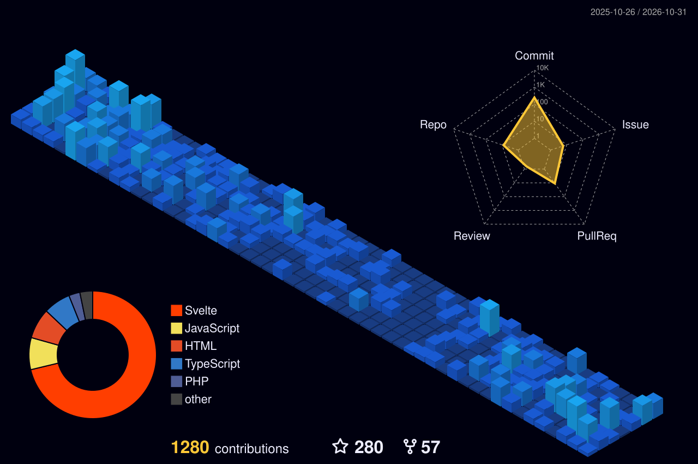

I'm Rukshan, currently working as a Health Informatics Specialist at the Swiss Tropical and Public Health Institute.

- 🔭 I am currently working on - [Alma](https://almacare.ch) and [Entangle](https://entangle.ch)
- 🌱 I am currently learning - Svelte
- ⚡ Fun fact: If you ask me what's my purpose, I love making things that people use.

Interested in,

- 🔥 Interoperability in healthcare - FHIR 
- 🏥 Digital health systems development and implementation
- 🤔 Health inforamtics 
- 💬 Open data governence 

**I love making new things. If you have project and you're in need help, let me know, I'm happy to provide you a hand.**

* ✍️ Read my blog - https://ruky.me
* ☕ Buy me a coffee - https://buymeacoffee.com/rukshan
* 📫 How to reach me - rukshan@ruky.me
<!--
**rukshn/rukshn** is a ✨ _special_ ✨ repository because its `README.md` (this file) appears on your GitHub profile.

Here are some ideas to get you started:

- 🔭 I’m currently working on ...
- 🌱 I’m currently learning ...
- 👯 I’m looking to collaborate on ...
- 🤔 I’m looking for help with ...
- 💬 Ask me about ...
- 📫 How to reach me: ...
- 😄 Pronouns: ...
- ⚡ Fun fact: ...
-->
